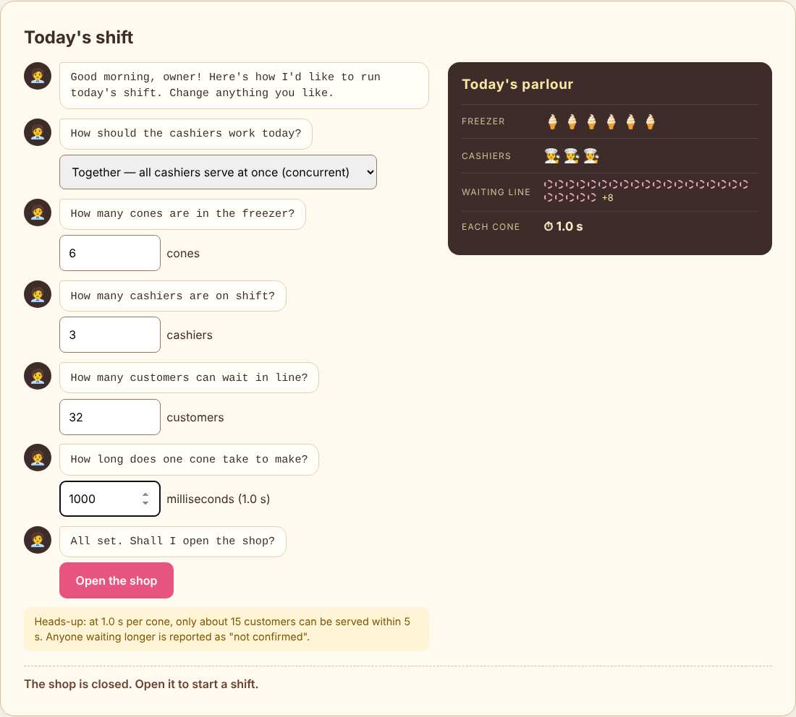
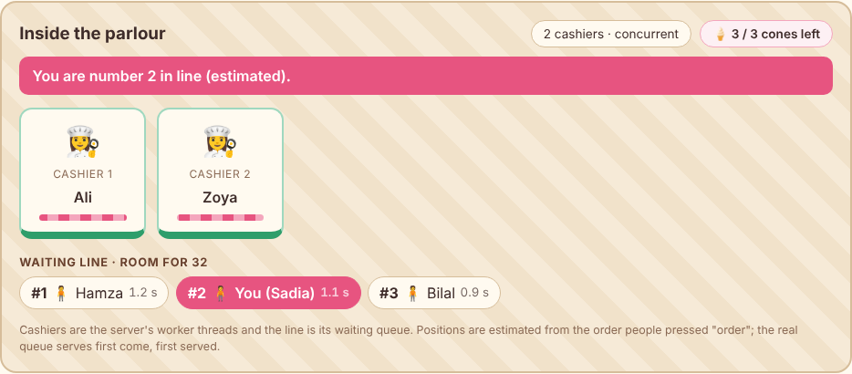
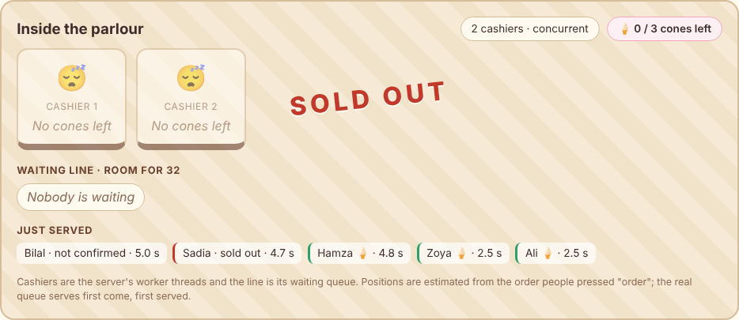
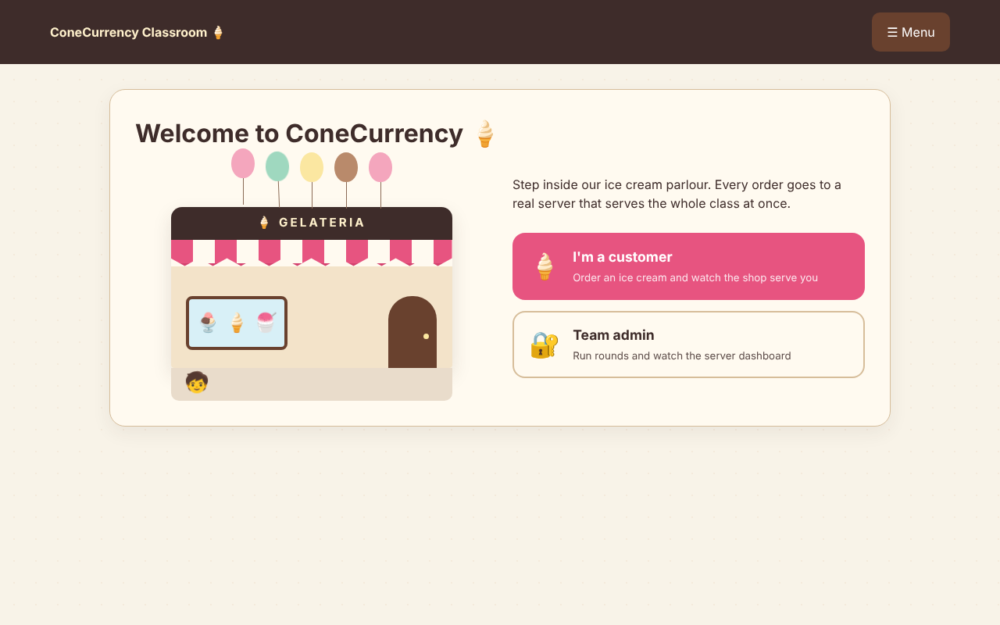
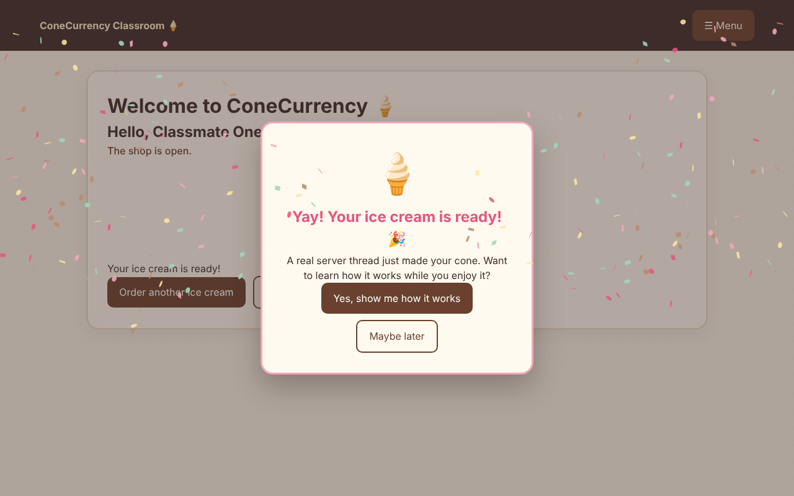

# ConeCurrency 🍦

The classroom student/admin web workflows and compatibility fixes are documented
in [web/CLASSROOM.md](web/CLASSROOM.md). The original dashboard remains available
after admin sign-in; the bridge can manage the real C server in either mode.

ConeCurrency compares sequential and concurrent ice cream ordering using C,
Linux TCP sockets and POSIX threads. One BOOK reserves one cone from shared
inventory. Both modes reuse the same handler and mutex-protected booking engine.

## Team contributions preserved

| Owner | Original components used in the integrated application |
| --- | --- |
| P1 — AQ / Abdul Qudoos | Booking mutex, inventory, statistics, load tester, race proof, demo script |
| P2 — Khadija | Networking, request handler, sequential loop, CLI, benchmarks, shared setup |
| P3 — Sadia Fatima | Bounded queue, worker pool, concurrent accept loop and shutdown |
| GUI — Abdul Qudoos & Sadia Fatima | Abdul Qudoos: original Python interfaces and the React gelateria dashboard. Sadia Fatima: customer interface (welcome, menu, live shop floor, order history, celebration, customer guide) and admin interface (owner sign-in, manager's shift briefing with live preview, customers list). The classroom bridge adds student/admin workflows |

## Sadia Fatima's contributions

| Area | What Sadia built | Read more |
| --- | --- | --- |
| **Concurrency engine (C)** | Bounded thread-safe queue (mutex + condition variable), fixed worker thread pool, concurrent accept loop with `ERR BUSY` load shedding, clean Ctrl+C shutdown; unit, integration and sanitizer tests with their own CI workflow | [P3 concurrency engine](#p3-concurrency-engine), [design doc](docs/CONCURRENCY_ENGINE.md) |
| **Customer interface (web)** | Animated parlour welcome, customer/admin choice, ☰ menu with About us and How it works, leave-and-return, wobbling-cone / sold-out / busy states, confetti, measured served time, order history, live shop floor (cashiers = worker threads, line = queue), "What's happening here?" guide | [Student experience](web/CLASSROOM.md#student-experience), [plan](docs/STUDENT_UI_PLAN.md) |
| **Admin interface (web)** | Owner sign-in, the manager's typed shift briefing with a live parlour preview, plain-language shift status, Customers list, parlour-only dashboard, scoops drawn on the cone, customer-facing wording throughout | [Admin experience](web/CLASSROOM.md#admin-experience), [plan](docs/ADMIN_UI_PLAN.md) |
| **Quality and testing** | ThreadSanitizer, AddressSanitizer and UndefinedBehaviorSanitizer runs on the concurrency engine, thread-safety review of the shutdown path, How it works pages matched to the real `OK BOOKED` reply, web tests grown from 42 to 96 | [Run P3's checks](#run-p3s-checks) |



`make all` now builds one production binary supporting both server modes using
all three owners' real modules. The P1 test substitute is retained only for P2's
isolated checks. The BOOK protocol and original module boundaries are preserved.

## Ubuntu fresh checkout

| Area | Delivered | Remaining |
| --- | --- | --- |
| P2 networking | TCP listener, request handler, sequential server, CLI, timeouts, shutdown, tests | Benchmarks across full integrated system |
| P2 benchmarks | Measurement driver, CSV output, graph tool, system-call demo script | Run both real modes and collect actual results |
| Shared setup | Folders, Makefile, Linux test workflow, protocol and C headers | Fully integrated |
| P1 synchronization | Real booking engine (`booking.c`), POSIX mutex, thread-safe stats (`stats.c`), load tester (`load_test.py`), race proof (`test_race.py`), demo script (`demo.sh`) | Final joint benchmark run |
| P3 concurrency | Bounded queue, worker pool, concurrent mode and tests | Final joint benchmark run |
| GUI | Artisanal Ice Cream Parlour Web UI (`tools/gui.py`) & Desktop UI (`tools/desktop_gui.py`) | Ready to run |
Verification targets: Ubuntu 22.04 and 24.04, GCC 11+ (C11/POSIX threads), GNU
Make 4.3+, Python 3.10+, Bash 5. Core Python tools use the standard library;
Matplotlib is needed only for graphs.

```sh
sudo apt-get update
sudo apt-get install -y build-essential git python3 python3-matplotlib netcat-openbsd strace gdb
git clone https://github.com/abbasikhadija/ConeCurrency.git
cd ConeCurrency
make all
make test
```

The integrated application is available on main. After cloning,
`bash scripts/setup_ubuntu.sh` installs the same packages, builds
and tests automatically. Run inside Ubuntu (native, VM or WSL Ubuntu), rather
than Windows PowerShell. No database, migration, API key, secrets, `.env` file,
or environment variable is required. Inventory is in memory and resets to
`--tickets` each time the server starts. It binds to **127.0.0.1** for local
clients. The web classroom uses the Node HTTP/WebSocket bridge in web/; see
web/CLASSROOM.md for its environment and admin setup.

## Start and place an order

Terminal 1 (choose one; stop it with Ctrl+C before changing modes):

```sh
bash scripts/start.sh sequential --tickets 10 --port 8080 --delay-ms 20
# Or:
bash scripts/start.sh concurrent --tickets 10 --workers 4 --queue 32 --port 8080 --delay-ms 20
```

The script builds if needed and executes the same production binary as:

```sh
./ticket-server --mode concurrent --tickets 10 --workers 4 --queue 32 --port 8080 --delay-ms 20
```

Terminal 2:

```sh
printf 'BOOK\n' | nc -N 127.0.0.1 8080
python3 tools/load_test.py --port 8080 --users 20 --csv /tmp/conecurrency-orders.csv
```

Replies are `OK BOOKED`, `ERR SOLD_OUT`, `ERR BAD_REQUEST`, or `ERR BUSY`, each
ending in LF. One connection carries one order. Ctrl+C prints final statistics.
A lost reply can follow a successful booking; clients must not blindly retry.
If a port is occupied, choose another port for both server and client.

| Flag | Default | Accepted values |
| --- | --- | --- |
| --mode | sequential | sequential or concurrent |
| --tickets | 10 | 0..2147483647 on supported Ubuntu targets |
| --workers | 4 | 1..1024 |
| --queue | 32 | 1..1000000 |
| --port | 8080 | 1..65535 |
| --delay-ms | 20 | 0..60000; fake work outside all locks |

## Full verification and original demos

```sh
make test
bash scripts/demo.sh all
make unsafe
python3 tests/test_race.py --demo
```

`make test` builds and runs booking, queue, pool and descriptor-ownership C
checks; P2's isolated networking tests; the same networking tests with real
inventory; P3 concurrent tests; P1's 20 repeated one-ticket/20-client checks;
and integrated client/CSV/startup/restart tests. Required binaries are built
first to avoid missing-binary skips. Focused targets remain: `make test-p1`,
`make test-p2`, `make test-p3`, `make test-race`. `make concurrent` is an alias
for the dual-mode production build.

The optional unsafe demonstration remains at `build/ticket-server-unsafe` and
never replaces production. Unsafe overselling depends on scheduling; a run may
show no violation. No finite set of tests proves all concurrency bugs absent.
`PORT=8081 bash scripts/demo.sh all` changes the demo port. Test-only overrides:
P2_TEST_SERVER, P3_TEST_SERVER, SAFE_SERVER, UNSAFE_SERVER; SANITIZER_THREADS=1
includes ThreadSanitizer's helper in the thread-count assertion.

## Benchmarks, graphs and system calls

```sh
bash scripts/run_benchmarks.sh
# Substitute the timestamp directory printed by the driver:
python3 tools/plot_benchmarks.py benchmarks/results/RUN_DIRECTORY/summary.csv
bash scripts/system_calls.sh
# Send a BOOK from another terminal; for a running server's descriptors:
bash scripts/system_calls.sh SERVER_PID
```

Benchmarks measure both real modes at 1/10/50/100 users, three repetitions,
identical stock and fake work. CSV, server logs and configuration/commit identity
are stored under benchmarks/results. Graphs show actual measurements only.
Ubuntu CI uploads those files as artifacts. Shared-runner measurements verify
the pipeline; they are not controlled performance claims.

See [protocol](docs/protocol.md), [integration notes](docs/integration.md), and
[verification evidence](docs/verification.md). The original component design
explanations follow; current setup/build instructions above take precedence.

## P3 concurrency engine

**Status update:** P3 delivered queue, pool and concurrent mode in PR #2.
These now connect to P1's real inventory/statistics through P2's shared handler.

P3 turns the server from "one cashier" into "many cashiers". The main thread
only accepts customers; a fixed team of worker threads serves them.

```
customers ──► accept loop ──► bounded queue ──► worker 1 ─┐
              (main thread)    [■■■□□□□□]   ──► worker 2 ─┼─► handle_client ─► booking (mutex)
                    │                       ──► worker N ─┘
                    └─► queue full? reply ERR BUSY and close
```

| File | Ice cream shop | What it does |
| --- | --- | --- |
| `src/queue.c` | The rope line | Bounded FIFO of client sockets. One mutex protects it; a condition variable lets idle workers sleep instead of busy-waiting. Never blocks the accept loop: a full queue is rejected immediately. |
| `src/threadpool.c` | The cashier team | Starts `--workers` POSIX threads once. Each repeats: take a client from the queue, call `handle_client`, close the socket. SIGINT/SIGTERM are blocked in workers so only the main thread receives Ctrl+C. |
| `src/concurrent.c` | The door manager | `poll()` every 500 ms (so Ctrl+C is noticed promptly), `accept()`, push to the queue or reply `ERR BUSY`. On shutdown: close the queue, wake and join all workers, free the queue. |

### Key design decisions

- **Fixed thread pool**, not one thread per client: resource use is capped.
- **Load shedding:** when the queue is full the client gets `ERR BUSY` at once
  instead of waiting forever.
- **Condition variable with a `while` re-check:** idle workers use 0% CPU and are
  safe against spurious wakeups.
- **No deadlock by design:** a worker releases the queue lock before calling the
  handler, so no thread ever holds the queue lock and the booking lock together.
- **One owner per socket:** the accept thread owns a client until it is queued;
  after that the worker that takes it is the only one that closes it.

### Run P3's checks

```sh
CFLAGS="-std=c11 -D_POSIX_C_SOURCE=200809L -Iinclude -Wall -Wextra -Werror -g"
mkdir -p build

# Queue and thread pool unit tests
gcc $CFLAGS -O2 src/queue.c tests/test_queue.c -o build/test-queue -pthread && ./build/test-queue
gcc $CFLAGS -O2 src/queue.c src/threadpool.c tests/test_threadpool.c -o build/test-threadpool -pthread && ./build/test-threadpool

# Data race detection
gcc $CFLAGS -fsanitize=thread src/queue.c src/threadpool.c tests/test_threadpool.c -o build/test-threadpool-tsan -pthread && ./build/test-threadpool-tsan

# Full server in concurrent mode with real P1 inventory, plus integration tests
gcc $CFLAGS -O2 -DWITH_CONCURRENT src/main.c src/options.c src/network.c src/handler.c src/sequential.c \
    src/booking.c src/stats.c src/queue.c src/threadpool.c src/concurrent.c -o build/p3-test-server -pthread
python3 -m unittest tests.test_concurrent -v
```

The same checks run automatically on every push and pull request in
`.github/workflows/p3-tests.yml`, including ThreadSanitizer, AddressSanitizer
and UndefinedBehaviorSanitizer.

This build tests workers, queue rejection and shutdown with real inventory.
The repeated inventory invariant check is supplied by `make test-race`.

### Try concurrent mode

Terminal 1:

```sh
./build/p3-test-server --mode concurrent --workers 4 --queue 8 --tickets 5 --delay-ms 100
```

Terminal 2:

```sh
ps -L -p $(pgrep p3-test-server) -o pid,tid,stat,comm      # 1 main thread + 4 workers
for i in 1 2 3 4 5 6 7; do printf 'BOOK\n' | nc -N 127.0.0.1 8080 & done; wait
```

Overload: restart terminal 1 with `--workers 1 --queue 1 --delay-ms 500` and run
the same burst; some customers receive `ERR BUSY` and the server keeps working.
Press Ctrl+C in terminal 1 for a clean shutdown with final statistics.

`make concurrent` builds the integrated production server:

```sh
make concurrent
./ticket-server --mode concurrent --tickets 10 --workers 4 --queue 32 --port 8080 --delay-ms 20
```

Full design, timelines and tests: [P3 concurrency engine](docs/CONCURRENCY_ENGINE.md).

### See P3 live: the classroom shop floor

The student page of the classroom app (`web/`, built by Sadia Fatima) turns the
queue and worker pool into something the whole class can watch. Each student's
order is a real `BOOK` to the C server.



| On screen | In the C server |
|---|---|
| Cashier counters | Worker threads started by `pool_start` (`--workers`) |
| Waiting line with names | Clients waiting in the bounded queue (`queue_try_push` / `queue_pop`) |
| "Room for 32" | Queue capacity (`--queue`) |
| "Line full right now" | `ERR BUSY` from the accept loop when `queue_try_push` fails |
| Served times stepping up (2.5 s, 2.5 s, 4.8 s…) | Customers waiting for a free worker |
| Sleeping cashiers and SOLD OUT | Inventory exhausted; workers idle in `pthread_cond_wait` |



Who stands at which counter is estimated from arrival order, because the real
queue is first come, first served and the C server does not report positions.
The welcome screen, confetti, order history and the rest of the student design
are described in [web/CLASSROOM.md](web/CLASSROOM.md#student-experience).

<p>
  
  
</p>

## P1 synchronization engine

**Status update:** Person 1 (AQ) has delivered `src/booking.c`, `src/stats.c`, unit tests in `tests/test_booking.c`, the barrier-synchronized Python load tester `tools/load_test.py`, the race condition verification suite `tests/test_race.py`, and the unified demo script `scripts/demo.sh`.

P1 guarantees that no matter how many worker threads or simultaneous client requests arrive, the shared cone inventory is never oversold or double-booked.

```
Worker 1 ──┐                                   ┌── OK BOOKED (inventory decremented)
Worker 2 ──┼──► pthread_mutex_lock(&lock) ──► ┤
Worker N ──┘     [ Critical Section: Check     └── ERR SOLD_OUT (inventory == 0)
                 and decrement remaining ]
                 pthread_mutex_unlock(&lock)
```

| File | Ice cream shop | What it does |
| --- | --- | --- |
| `src/booking.c` | The inventory vault | Shared counter of cones (`remaining`). Wrapped in a POSIX mutex (`pthread_mutex_t`). Atomically tests `remaining > 0` and decrements. In unsafe demo mode (`-DUNSAFE_MODE`), the lock is omitted to prove race hazards. |
| `src/stats.c` | The ledger | Thread-safe counters for `BOOKED`, `SOLD_OUT`, `BUSY`, and `BAD`. Synchronized with a dedicated mutex and printed on server termination. |
| `tests/test_booking.c` | Unit validation | Standalone assertions verifying single-thread depletion and 100 concurrent threads competing for 50 tickets. |
| `tools/load_test.py` | The rush hour simulator | Python tool using `threading.Barrier` so all user threads send `BOOK\n` after a shared barrier release (scheduling varies), calculating throughput, median latency, and error breakdown. |
| `tests/test_race.py` | Race condition proof | Runs 1 ticket vs 20 concurrent users over 20 iterations. In safe mode, `booked == 1` always; in unsafe mode, overselling is detected. |
| `scripts/demo.sh` | Evaluation script | Shell runner demonstrating sequential, concurrent, race condition, overload shedding, and invalid request scenarios. |

### Key design decisions

- **Shortest possible critical section:** Artificial delays and network I/O occur completely outside the mutex. Threads only hold the lock for the single memory comparison and decrement (~nanoseconds).
- **Deadlock prevention:** No thread ever holds the queue lock and inventory lock at the same time.
- **Barrier synchronization:** The Python load tester synchronizes all threads with `threading.Barrier`, ensuring maximum concurrency collision.

### Run P1's checks

```sh
# Run booking and concurrency unit tests
make build/test-booking && ./build/test-booking

# Run with ThreadSanitizer (detects races in the tested execution)
gcc -std=c11 -D_POSIX_C_SOURCE=200809L -Iinclude -Wall -Wextra -Werror -g \
    -fsanitize=thread src/booking.c src/stats.c tests/test_booking.c -o build/test-booking-tsan -pthread
./build/test-booking-tsan

# Run race condition verification (20 iterations)
make concurrent
python3 tests/test_race.py

# Run comparative Safe vs Unsafe demonstration
make unsafe
python3 tests/test_race.py --demo

# Run unified demo script
bash scripts/demo.sh all
```

## Ice Cream Parlour UI (Interactive Gelateria Dashboard)

*GUI by Abdul Qudoos (gelateria dashboard, Python and desktop interfaces) and Sadia Fatima
(classroom student interface — see [Student experience](web/CLASSROOM.md#student-experience)).*

The project includes two visual dashboard options:
1. **Modern Production Web App (`web/`):** React 18 + Vite + TypeScript + Framer Motion + Node.js TCP/WebSocket Bridge + Interactive OS Learn Section (CSC-251L).
2. **Lightweight Python & Desktop Clients (`tools/`):** Zero-dependency Python HTTP server (`tools/gui.py`) and Tkinter client (`tools/desktop_gui.py`).

### Running the React 18 + Node.js Web Dashboard (`web/`)

```bash
# 1. Start all components with a simulated mock C backend:
cd web
npm run dev:all

# 2. Or point to your real compiled C concurrent server:
# Terminal 1:
./ticket-server --mode concurrent --tickets 50 --workers 4 --queue 16 --port 8080 --delay-ms 20
# Terminal 2:
npm run dev:bridge &
npm run dev
```

Visit `http://127.0.0.1:5173` in your browser. All unit, component, and bridge integration tests run via `npm test`.

---

```
[ React 18 UI / Desktop ]
          │
          │ WebSocket / TCP Bridge (Port 3001)
          ▼
┌────────────────────────────────────────────────────────┐
│  ConeCurrency C Server (or Mock TCP Backend) :8080     │
│  - Door Manager / Accept Loop                          │
│  - Bounded FIFO Queue (Load Shedding -> ERR BUSY)      │
│  - Worker Thread Pool (Cashiers)                       │
│  - Mutex-Protected Shared Inventory (booking.c)       │
└────────────────────────────────────────────────────────┘
```

### UI Features

- **Live Waffle Cone Visualizer:** Each successful booking (`OK BOOKED`) dynamically drops a new flavored gelato scoop (strawberry, pistachio, vanilla, chocolate) onto the waffle cone.
- **Real-Time POS Register Tape:** A live ticker prints the exact millisecond round-trip response time and reply status for every TCP request.
- **Barrier-Synchronized Rush Hours:** The "Rush Hour" (10 users) and "Flash Mob" (25 users) buttons use Python's `threading.Barrier` to synchronize client threads, ensuring every request hits the server at the exact same microsecond to visually demonstrate worker pool concurrency and queue shedding (`ERR BUSY`).
- **Resilience Testing:** The "Send Bad Request" button transmits malformed payloads (`GARBAGE_PAYLOAD\n`) to verify that the server rejects invalid commands without crashing.

---

### How to Run the UI

You can choose between the **zero-dependency Web Dashboard** (recommended) or the **native X11 Desktop App**.

#### Option 1: Web-Based Dashboard (Recommended for Ubuntu & WSL)

The web dashboard uses only Python 3's built-in standard library (`http.server`, `socket`, `threading`). It requires **zero pip dependencies**, runs out-of-the-box on native Ubuntu or inside Windows Subsystem for Linux (WSL), and automatically opens in your default browser.

1. **Terminal 1: Start the C Ticket Server**
   ```bash
   # Build and launch concurrent server with 20 tickets, 4 workers, and 100ms delay:
   make concurrent
   ./ticket-server --mode concurrent --tickets 20 --workers 4 --queue 16 --port 8080 --delay-ms 100
   ```

2. **Terminal 2: Launch the Web UI**
   ```bash
   make gui
   # Or directly:
   python3 tools/gui.py
   ```
   * The dashboard will start at `http://127.0.0.1:5050` and automatically pop open in your browser.
   * If running inside headless SSH, simply forward port `5050` or open `http://<ip-address>:5050`.

---

#### Option 2: Native Desktop Window App (Tkinter)

If you prefer a native desktop application window running via X11/Wayland on Ubuntu desktop:

1. **Install Tkinter (if not already installed on Ubuntu):**
   ```bash
   sudo apt update && sudo apt install -y python3-tk
   ```

2. **Terminal 1: Start the C Ticket Server**
   ```bash
   ./ticket-server --mode concurrent --tickets 20 --workers 4 --queue 16 --port 8080 --delay-ms 100
   ```

3. **Terminal 2: Launch the Desktop Client**
   ```bash
   make desktop-gui
   # Or directly:
   python3 tools/desktop_gui.py
   ```

---

### Demonstrating Concurrency Live from the UI

To demonstrate the operating system concepts live in a presentation or lab evaluation:

1. **Single Order vs. Rush Hour:**
   - Click **Order 1 Cone (BOOK)** $\rightarrow$ Notice the single ticket print on the register tape in ~100ms and a scoop added to the cone.
   - Click **Rush Hour (10 Cones)** $\rightarrow$ 10 orders hit simultaneously. With 4 worker threads, 4 orders are served in parallel (~100ms), followed immediately by the next batches.
2. **Queue Overload & Load Shedding:**
   - Restart the server with a tiny queue: `./ticket-server --mode concurrent --workers 1 --queue 2 --delay-ms 500`.
   - Click **Flash Mob (25 Cones)** in the UI $\rightarrow$ Watch the register tape immediately log orange `ERR BUSY` entries, proving that the bounded queue safely rejects excess connections without server crashing.
3. **Inventory Exhaustion:**
   - Start the server with only 5 tickets: `./ticket-server --mode concurrent --tickets 5 --workers 4`.
   - Click **Rush Hour (10 Cones)** $\rightarrow$ Exactly 5 orders succeed (`OK BOOKED`), and the remaining 5 immediately report red `ERR SOLD_OUT`.
